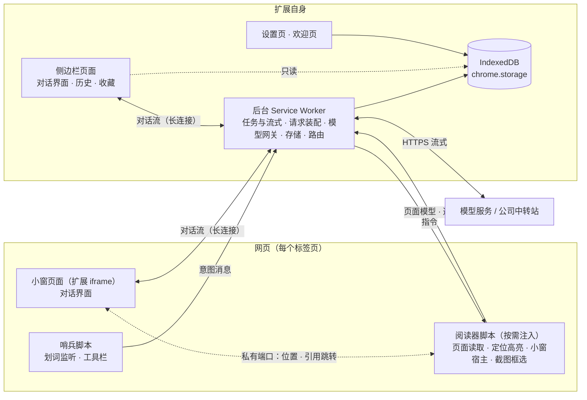
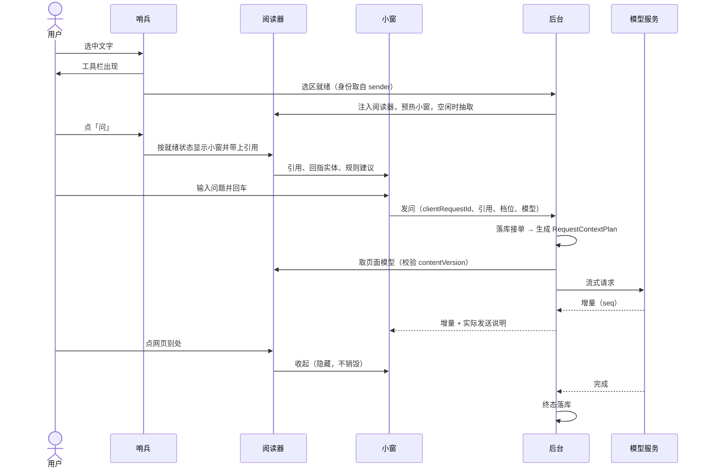
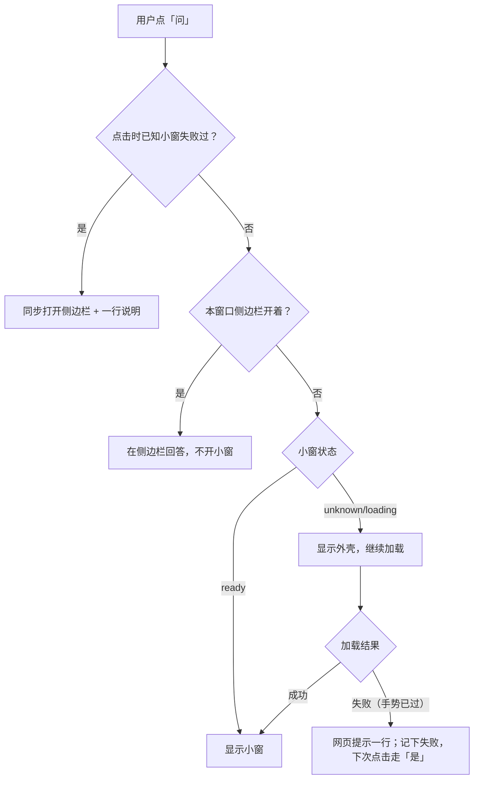

# ARCHITECTURE.md — AI 阅读助手扩展 架构设计与技术选型 v1.3

> 状态：v1.3，按核心功能开发的实现同步（决策 082–094）；v1.2 按原型验证结论修订（`docs/原型验证/PROTOTYPE_REPORT.md`，决策 065–081）。v1.1 按 `ADVERSARIAL_REVIEW.md`（2026-11-14）修订，评审 26 项发现的逐条处置见 `REVIEW_RESPONSE.md`；原型与验收一律以 `VALIDATION_MATRIX.md` 为准，本文第 9 节只写与架构绑定的门槛。
> 输入：`FINAL_PLAN.md` v1.3、`DECISIONS.md` 001–094、`PROJECT_ANALYSIS.md`、`ADVERSARIAL_REVIEW.md`、`VALIDATION_MATRIX.md`。
> 范围：技术栈、运行时架构、契约、数据与协议、工程结构、风险与门槛。不含代码、视觉稿和逐任务实施计划。
> 读者：实现者（人或 AI 代理）据此可以直接排计划。第 1 节写给不看技术细节的读者。
> 归属：需求编号（A1、D5 等）沿用 `FINAL_PLAN.md`。技术栈与架构由用户授权 Claude 决定；对体验、权限或原则有影响的决定见第 11 节，用户已答复的见第 12 节。
> 代号：产品名未定，代码内用占位代号 `ra`（reading assistant），标识符从一个常量派生。
> 日期：2026-11-13 初稿；2026-11-14 v1.0 定稿；2026-11-14 v1.1 按对抗性评审修订；2026-11-21 v1.2 按原型验证修订；2026-11-22 v1.3 按核心功能开发同步。

## 1. 一页结论

**技术栈**

| 层 | 选择 |
| --- | --- |
| 扩展规范 | Manifest V3，Chrome / Edge 141 起（Edge 同版能力另行实测，见 V-11） |
| 语言 | TypeScript（严格模式） |
| 构建与扩展框架 | WXT 0.21.x（锁定完整版本与 lockfile，底层是 Vite） |
| 界面框架 | Preact 11 + Signals；划词工具栏用原生 DOM |
| 样式 | 手写 CSS + 设计变量，以 SelectLingo 的设计规范为基准（MIT，保留许可声明） |
| 回答渲染 | markdown-it（禁用原始 HTML）+ KaTeX + highlight.js，后两者按需加载 |
| 本地数据 | IndexedDB 存对话、收藏、页面记录；`chrome.storage.local` 存设置与 Key（仅本机）；`chrome.storage.session` 存运行时状态 |
| 测试 | Vitest（纯逻辑）+ Playwright（真实浏览器）+ 本地模拟中转站 |
| 工具链 | pnpm、Biome、独立类型检查、依赖方向检查、GitHub Actions |

**三个最关键的架构决定**

1. **小窗是嵌在网页里的扩展来源 iframe。** 浏览器把它与网页隔开：网页脚本读不到对话，网页样式与快捷键影响不到它，界面渲染不在网页的 JS 主线程里执行（CPU、内存、合成资源仍然共享，须按 V-13 实测）。代价：冷启动要加载一个页面；极少数网站上不可用；宿主的遮挡、移除与外壳布局不由浏览器保证。
2. **后台是唯一的大脑，界面只是显示器。** 所有模型请求、任务状态、数据写入在后台完成；小窗与侧边栏只订阅。小窗收起、切标签页、转侧边栏都不打断生成；内网中转站只需后台能连。
3. **网页里的代码分两段，按需加载，并按站点权限矩阵决定注入。** 平时只有一个约 10 KB 的哨兵脚本；读取、定位、小窗宿主放在阅读器里，第一次交互时注入。两级黑名单的站点**不常驻任何脚本**。

**v1.1 相对 v1.0 的关键修正**

v1.0 有六处契约缺失或自相矛盾，评审已指出，本版逐条闭合：

| 契约 | v1.0 的问题 | v1.1 的处理 |
| --- | --- | --- |
| 站点权限 | 黑名单同时「排除注入」和「照常注入」 | 4.1 唯一权限矩阵 |
| 界面路由 | 假定预热必然完成 | 5.2 四态路由，冷启动单独定 |
| 任务协议 | 无幂等、无序号、无恢复 | 5.5 任务状态机 |
| 页面身份 | pageKey、文档、内容版本混为一谈 | 5.6 五个身份分清 |
| 请求装配 | 降档后旧全文仍随历史发出 | 5.9 每次请求一份发送计划 |
| 网络与参数 | 「只连登记地址」与图片、搜索、更新冲突 | 5.14 请求分类表；5.8 参数优先级 |

## 2. 架构要回答的问题

| 需求约束 | 对架构的要求 |
| --- | --- |
| 轻量、快速是最高准则；不拖慢网页（J6、验收 16） | 未交互时只有极小监听；重逻辑按需；界面不在网页主线程渲染；资源可回收 |
| 划词提问、总结都在两次操作内开始（验收 4） | 点击后不等加载；页面内容提前抽好；冷启动有明确取舍 |
| 小窗收起不打断生成（B4）；转侧边栏无缝续接（B6） | 任务属于后台，不属于任何界面；订阅可重连 |
| 所有 AI 请求由后台发出（H8） | 后台独占网络与密钥 |
| 网页脚本读不到对话（M7）；样式互不干扰（J5） | 浏览器级来源隔离 |
| 上下文三档、实体回指、截断提示、引用跳回（D、F） | 保留结构且能映射回位置的页面模型；请求与快照绑定 |
| 中转站容错与诊断（H7、H9、H11） | 适配器、响应校验、参数优先级、能力表 |
| 关闭的站点不留脚本（M5、A4） | 动态注册；两级黑名单不常驻 |
| 只在本机、可导出（H10、G2、K6） | 无后端；数据带导出能力；设置备份与数据备份分开 |
| 开源；主要靠 AI 辅助开发 | 主流技术；规则可自动检查 |

**不做**：后端、账号、遥测；`debugger`、`tabs`、`webNavigation`、`offscreen`（若原型证明必须引入，另起决策，见 5.5）；Firefox / Safari 兼容抽象；状态管理库、组件库、CSS 框架、向量库、通用模型 SDK。

## 3. 技术栈选型与理由

| 层 | 选择 | 理由 | 放弃的备选 |
| --- | --- | --- | --- |
| 扩展框架 | **WXT 0.21.x** | 文件约定生成清单；内容脚本打成独立自执行文件；运行时注册；iframe 界面辅助；开发热更新；打包 zip。**锁定实际验证的完整版本与 lockfile**；「退回纯 Vite」是应急手段，不是零成本选项 | CRXJS（SelectLingo 在用）：内容脚本靠动态 import，必须暴露为网页可访问资源，多一次异步且可被探测。Plasmo：绑定 React、维护放缓 |
| 界面框架 | **Preact 11 + @preact/signals** | 运行时约 5 KB；写法与 React 相同、资料多、贡献者上手快。**框架小不等于页面快**，性能由渲染策略与数据流决定，按 V-13 实测 | React：体积大。Svelte 5 / Solid / Vue / Lit：无明显优势。全部原生 DOM：聊天与设置开发慢 |
| 工具栏 | **原生 DOM + 封闭 Shadow DOM** | 常驻每个网页，必须最小；只有几个按钮，不需要框架。须覆盖键盘选择、输入法、焦点、无障碍 | 用 Preact 渲染：每页多一个运行时 |
| 样式 | **手写 CSS + CSS 变量 + CSS Modules** | 141 起可用原生嵌套、`light-dark()`、Popover、锚点定位，无需预处理器 | Tailwind / UnoCSS |
| Markdown | **markdown-it，`html: false`** | 禁原始 HTML 是必要基础；**不是安全终点**，自定义渲染器另行约束（5.10） | marked：默认不安全 |
| 公式 | **KaTeX**，按需加载 | 快；须设置 `trust:false`、展开与尺寸上限（5.10） | MathJax：更重 |
| 代码高亮 | **highlight.js 常用子集**，按需 | 技术文档与 GitHub 是主场景 | Shiki：重 |
| 结构化存储 | **IndexedDB + `idb`** | 按条读写、索引、可存图片。须定义事务、升级、清理、失败反馈（5.11） | Dexie。`chrome.storage.local` 存对话 |
| 设置 | **`chrome.storage.local`**，收紧为仅扩展自身 | 变更广播天然可用。**收紧顺序本身不能当作安全保证**，须按 V-05 验证启动窗口 | `storage.sync` |
| 正文抽取 | **自研 PageDoc；抽取算法暂不定案** | 必须保留块与原位置的对应。但「成熟库只能返回字符串」不成立——Readability 支持自定义 serializer 返回 DOM（S11）。V-08 公平比较三种方案后再定 | 直接依赖 Readability / Defuddle |
| 文本近似匹配 | **approx-string-match**（候选） | 小体积；未确认当前维护状态，须锁版本。先限定候选块与文本长度，绝不全页无界匹配 | 自写编辑距离；`dom-anchor-text-quote` |
| 中文分词 | **`Intl.Segmenter`** | 内置、零体积。**分词不是命名实体识别**，低频词不必然是专名；以证据召回率验收（V-08） | 打包分词库 |
| 国际化 | 自写类型化文案表；清单用 `_locales` | `chrome.i18n` 不能运行时切换语言 | `@wxt-dev/i18n` |
| 图标 | Lucide 按个内联 SVG | 许可宽松 | 图标字体 |
| 单元测试 | **Vitest + happy-dom** | 只证明纯数据逻辑：装配、预算、协议、解析、锚点算法。布局、计算样式、选区、跨源 iframe、权限必须在真实浏览器验证（V-01–V-13） | Jest |
| 端到端 | **Playwright**（附带 Chromium） | 能加载扩展做自动化。**远端 Chromium 通过不能替代真实 Chrome/Edge**（S14） | Puppeteer |
| 代码检查 | **Biome + `tsc --noEmit` + 依赖方向检查** | 格式检查不等于类型检查；规则 4.2 需要机器守 | ESLint + Prettier |
| 包管理 | pnpm，Node 当前 LTS（锁定实际版本） | — | npm / yarn |

## 4. 总体架构

### 4.1 站点权限矩阵（唯一口径）

三级站点设置，逐项列出允许什么。**这张表是唯一口径**，其他章节与它冲突时以它为准。

| 能力 | 正常 | 「不弹工具栏」 | 「不读取页面内容」 |
| --- | --- | --- | --- |
| 哨兵常驻 | 是 | **否** | **否** |
| 自动弹出工具栏 | 是 | 否 | 否 |
| 快捷键 / 右键唤起 | 是 | 是（按需注入） | 是（按需注入） |
| 读取用户显式选中的文字 | 是 | 是 | 是（唯一例外） |
| 读取正文、前后块、标题链、实体回指 | 是 | 是 | **否** |
| 缓存正文 | 是 | 是 | **否**，且清除该站旧缓存 |
| 截图 | 是 | 是 | 是（用户主动框选） |
| 提问前的模型建议 | 是 | 是 | **否**（规则建议也不需要正文，但不发请求） |
| 小窗 / 侧边栏 | 是 | 是 | 是，只能自由对话并在界面说明原因 |
| 计算或显示「实际发送说明」 | 是 | 是 | 只显示选中字数与「未读取页面」 |

- **生效时机**：后台策略**立即生效**——改设置的当下，新的请求就被拦截，待发任务取消，旧缓存标记失效。脚本层面的移除在下次页面加载生效，这只影响「自动弹出工具栏」，不影响隐私拦截。
- **「不读取」下的旧内容**：该站已有的历史消息照常显示，但再次发问时**不再携带**任何旧正文；界面提示「此站点的页面内容不会被读取」。
- **M5 的落实**：两级都通过动态注册排除，站点上不常驻任何脚本；快捷键与右键按需注入阅读器，用完即走，页面卸载后不存在。
- **子框架**：一个框架的策略按「顶层站点策略与框架来源策略取更严」执行（AR-14）。

### 4.2 运行环境与职责



| 部分 | 运行位置 | 职责 | 不做什么 |
| --- | --- | --- | --- |
| 哨兵 | 网页，隔离环境，所有框架，仅正常站点 | 监听选区；显示工具栏；把点击变成意图 | 不读正文，不发网络请求，不持有对话 |
| 阅读器 | 网页，隔离环境，按需 | 读页面模型；定位高亮；创建与摆放小窗 iframe；截图框选 | 不发网络请求，不持有对话内容 |
| 小窗页面 | 扩展来源 iframe，嵌在网页顶层 | 紧凑对话界面 | 不直接访问模型服务或数据库 |
| 侧边栏页面 | 扩展页面 | 完整对话、历史、收藏 | 同上；只能只读查询 |
| 后台 | Service Worker，**唯一特权方** | 任务、装配、网络、数据写入、菜单与快捷键、脚本注册、截图 | 不把关键状态只放内存 |
| 设置 / 欢迎页 | 扩展页面 | 设置、向导、上手 | — |

### 4.3 不可违反的架构规则

写进项目根目录的代理说明，并尽量用检查工具守住。

1. **只有后台发模型请求。** 页面脚本和界面页面都不访问模型服务（H8）。
2. **生成任务归后台所有。** 界面只订阅；界面消失不影响任务（B4）。
3. **网页里常驻的只有哨兵，且只在正常站点。** 哨兵无第三方依赖，加载时不读写 DOM、不建观察器（J6、M5、4.1）。
4. **对话内容只出现在扩展页面里。** 不进入网页 DOM，不经过 `window.postMessage`（M7）。
5. **页面内容和模型输出都是不可信数据。** 页面内容只作为数据拼进提示词；模型输出不产生原始 HTML；回答里的外链图片一律不抓取、不显示，只显示域名占位（D14）。
6. **后台的请求目标必须可见、可审查。** 只发 5.14 请求分类表里的类别；来自内容脚本的消息不能携带请求地址或密钥（M8）。**不得**因模型输出或页面内容里出现某个网址就去抓——URL 本身能夹带数据。
7. **身份取自发送者，不取自消息内容。** 后台从 `sender` 获取 `tabId`、`frameId`、`documentId`、扩展页面来源；内容脚本自报的归属一律不可信（5.12）。
8. **每次请求有一份发送计划。** 实际发什么由请求装配产出并快照保存，界面显示的和发出去的必须能对上（5.9）。
9. **引用与快照绑定。** 编号只在「那一次请求发送的块集合」里有效（5.7）。
10. **打开侧边栏的调用必须在用户操作事件的同步路径上发出**，之前不得 `await` 任何东西。退出、关闭不受此限。
11. **`core/` 是纯逻辑，不依赖浏览器扩展 API**，可在 Node 里单测。**页面侧代码（`page/`）不引用界面代码（`ui/`）**。
12. **只响应真实的用户事件（`isTrusted`）。** 网页伪造的选区或点击不能触发请求；但 `isTrusted` 也不等于用户批准了消息里的所有数据，授权另按 5.12 判定。

### 4.4 契约总表（评审要求的六张表）

| 契约 | 位置 | 解决 |
| --- | --- | --- |
| 站点权限矩阵 | 4.1 | AR-01、07、10、14、18 |
| 界面路由状态机 | 5.2、5.3 | AR-02、19、23 |
| 任务状态与消息协议 | 5.5、5.12 | AR-03、04、05 |
| 页面与请求身份 | 5.6、5.7、5.9 | AR-06、07、14、15、16 |
| 网络与模型参数 | 5.8、5.14 | AR-08、09、10、25 |
| 分期验收与数据 | 5.11、10 | AR-17、20、22、24、26 |

## 5. 关键设计

### 5.1 页面侧：两段式注入

| | 哨兵 | 阅读器 |
| --- | --- | --- |
| 进入时机 | 页面空闲时自动注入（动态注册的内容脚本），**仅正常站点** | 用户首次交互（划词、快捷键、右键）时由后台注入；两级黑名单站点也按需注入 |
| 依赖 | 无 | 可含小型依赖 |
| 体积目标（gzip，参考值，见 5.15） | ≤ 10 KB | ≤ 50 KB |
| 加载时做的事 | 挂 2–3 个被动事件监听 | 无；抽取在发问时按时间片分段执行 |

- **动态注册**：后台用 `scripting.registerContentScripts` 注册哨兵，两级黑名单进 `excludeMatches`。安装、启动、黑名单变更时对账注册表。
- **安装前已打开的网页**：安装时后台向所有已打开的普通网页注入哨兵（L5）；失败的页面在用户按快捷键时提示刷新。
- **子框架**：哨兵在所有框架里运行，面积过小的直接退出；工具栏显示在选区所在框架；小窗永远在顶层框架；子框架里工具栏可能显示不全，靠右键菜单兜底（A8）。
- **两段之间**：同一网页同一隔离环境，通过全局符号上的小事件总线通信，不经过后台。
- **换页检测**：每次使用前校验 `contentVersion`（5.6），变了就重新抽取。只在小窗或侧边栏打开期间挂变更观察器，仅用于提示「页面已变化」。
- **右键菜单**：选中文字由浏览器直接给出（`info.selectionText`），不依赖哨兵；需要小窗时按需注入阅读器。浏览器内部页面不显示或点后说明不可用。

### 5.2 工具栏与冷启动路由

- 封闭 Shadow DOM + Popover 顶层；样式全用 `px`；定位用选区最后一行的矩形，下方放不下翻到上方（A5）。只读输入框拿不到文字矩形时，用松开鼠标的位置定位（A1）。
- 输入框、可编辑区域不弹；密码框与所有表单输入的值不读；唯一例外是只读多行输入框（A1、M6）。**选区策略统一在一个 `SelectionPolicy` 里实现，工具栏、右键、快捷键、降级抽取、诊断都走它**（AR-18）。
- 代码块或代码页只读输入框里，第一个按钮换成「解释代码」（A6）。
- 配置由后台按需下发并缓存（设置存储对内容脚本不可读，见 5.11）。
- 工具栏出现即预热：通知后台注入阅读器、创建隐藏的小窗 iframe，并回告这次提问去小窗还是侧边栏（B7）。**预热不抽取正文**：正文在真正发问时抽取并重算内容指纹（决策 067；V-13 实测空闲页、只划词都不抽取）。隐藏小窗的回收见 5.3。

**小窗就绪状态机**（`unknown → loading → ready | failedUnsupported | failedTransient`）

| 状态 | 含义 | 「问」被点击时 | 用户看到 |
| --- | --- | --- | --- |
| unknown | 还没试过 | 当场开始加载，显示小窗骨架，不等加载完成就接受输入 | 小窗立即出现，内容随加载补齐 |
| loading | 正在加载 | 同上，不重复创建 | 同上 |
| ready | 已加载并完成握手 | 直接显示 | 立即 |
| failedUnsupported | 该网站结构性不可用（如严格嵌入策略） | 同步打开侧边栏（仍在用户手势内） | 侧边栏顶部一行小字说明，同站只提示一次 |
| failedTransient | 超时、网页移除宿主等偶发失败 | 点击时已知：同步打开侧边栏；只改走一次，之后重新试小窗 | 侧边栏顶部「小窗这次没能加载出来，已改在侧边栏继续。」 |

- **点击时同步打开侧边栏**（决策 073）：网页工具栏的点击经 `runtime.sendMessage` 到后台，后台在处理函数的同一个同步段里读就绪状态的内存副本（唤醒时从 `storage.session` 补回）、当场 `sidePanel.open`，之后才存选区、推引用。Chrome 159 / Edge 157 实测能打开；之前有任何 `await` 或推迟就被拒（V-11）。打不开时在网页上显示一行不挡输入的提示。
- **点击之后才失败**（加载超时、网页移除宿主）：手势已过，不能替用户打开侧边栏，只能在网页上提示一行，并记下 failedTransient，下次点击同步打开（V-02，用户确认接受多一步，决策 079）。
- **结构性失败按站点缓存 30 天**，浏览器大版本更新后失效；偶发失败不永久代表整个站点（AR-02）。目前没有任何判定会产生 failedUnsupported（扩展 iframe 不受网页 `frame-src` 限制），缓存也未实现，留到核心功能阶段。
- **代价写在明处**：冷启动时小窗先出骨架、内容后到，首次打开的「可交互」时间可能超过 200 ms 的目标；失败时可能要多点一次「在侧边栏继续」。这是选择「总是优先小窗」换来的，见第 12 节。实测冷态点「问」到小窗可见 p95 43–68 ms（V-13，本地合成页面与模拟中转站）。
- **快捷键唤起**（无选区）：小窗是内容脚本创建的，不需要用户手势，所以直接走小窗路径；小窗失败过、或这一页放不了小窗（浏览器内部页面，看不到地址）时同步开侧边栏，后者不提示小窗失败。明说要小窗，所以不看侧边栏开没开（5.4）。

### 5.3 小窗：嵌在网页里的扩展页面

**方案比较**

| 方案 | 隔离 | 键盘与输入法 | 对网页的影响 | 结论 |
| --- | --- | --- | --- | --- |
| 网页内 Shadow DOM 渲染 | 样式基本隔离；网页脚本仍能监听键盘事件，M7 无法保证 | 网页快捷键会抢按键 | 渲染占用网页主线程 | 不采用 |
| **扩展页面 iframe** | 浏览器级来源隔离，跨进程 | 不受网页影响 | 渲染不在网页主线程；CPU / 内存 / 合成仍共享 | **采用** |
| 独立系统窗口 | 完全隔离 | 不受影响 | 无 | 需求已否决（不能置顶）。文档画中画能置顶但带浏览器标题栏、依附打开它的页面 |

**实现要点**

- 阅读器在顶层框架创建宿主（封闭 Shadow DOM + Popover 顶层），内放 iframe，地址是扩展内 `float.html`；声明为网页可访问资源，开启动态地址（`use_dynamic_url`）。网页的 `frame-src` 不影响扩展页面的嵌入。
- **握手令牌**：后台生成 128 位随机、一次性、60 秒有效的令牌，绑定 `tabId + documentId`，存在 `storage.session`，原子消费。小窗页面连接时出示令牌，后台核对来源。无有效令牌时页面保持空白。**令牌不携带 Key、对话内容或页面内容。**
- **有限防护声明**：这能阻止未授权嵌入与跨页订阅，但**不能**声称宿主网页无法遮挡、移除或改变小窗外壳。需求 M7 的准确表述是「网页脚本读不到对话内容」，不是「网页无法影响小窗的显示」。
- **私有端口**：小窗页面用 `tabs.connect` 直连所在标签页的阅读器，传位置尺寸的恢复与回报、收起；引用跳转不走这里，和侧边栏一样经后台（`citation/locate`，决策 089）；**精确指定 frameId / documentId**，不使用 `window.postMessage`。
- **拖动与缩放**（B1，决策 069）：在宿主侧用把手（顶部拖动条、右下角缩放角）捕获指针，直接移动宿主；手势期间 iframe 不参与命中；结束后经私有端口把最终位置尺寸回报给小窗落盘。**不在 iframe 内捕获**：指针捕获不跨 iframe 边界，往外拖、拖进内容区都会丢移动事件，稳定可复现（V-12）。外壳上的按下不算「点网页别处」。同一页面里拖过之后保持位置，不再贴着新选区摆放。位置和大小记设置。
- **收起即隐藏，不销毁**（B3、B4）；页面跳转会销毁 iframe，重建后由后台补发快照。
- **预热与回收**：工具栏首次出现时创建隐藏 iframe；每个标签页最多一个。网页上已有小窗、后台又带新令牌来预热（握手失败、令牌过期，后台不知道这个文档有能用的小窗）时换新令牌重建，与「显示」同一规则。标签页隐藏 10 分钟或长时间无任务时销毁：**仍未实现**（决策 078，核心功能阶段也未接；30 个标签页实测各 1 个，合计 JS 堆约 79 MB）。
- **转到侧边栏**（B6）：按钮在扩展页面里，点击即合法用户操作，直接打开侧边栏；后台生成 `handoffId` 并绑定 `windowId + tabId + conversationId`；**侧边栏连接并订阅成功后才收起小窗**（AR-19）。流程见 6.4。
- **代码复制**：iframe 声明 `allow="clipboard-write"`；网页许可策略可能禁止，用 `execCommand` 兜底（V-12）。
- **已知约束**：下拉与气泡不能超出 iframe；模型选择做成窗内面板；小窗按标签页各一个；网页原生模态 `<dialog>` 打开时小窗不可交互，先关对话框（V-12，决策 071）；用过小窗的页面后退不进往返缓存（决策 071）。

### 5.4 侧边栏

- 每个窗口一个全局侧边栏；面板内监听标签页切换与地址变化，显示当前页的对话（C2）。监听器挂在面板自己身上，面板关着时不唤醒后台。
- **状态判断**：`runtime.getContexts` 能说明有没有侧边栏，但给的 `windowId` 是 -1（全局面板，Chrome 159 / Edge 157 实测），分不出窗口；哪个窗口开着靠面板握手时报的窗口（5.12）。`onOpened` / `onClosed`（141 / 142 起）为辅。后台被回收后握手登记是空的，判断方法见下「划词去向」。
- **开关快捷键**（决策 076）：`open()` 之前不能 `await`（规则 4.2.10）。快捷键处理里**总是同步调用 `open()`**，再把命令时间写进 `storage.session` 并广播切换事件；面板先挂监听再读记录，自己的 `performance.timeOrigin` 早于命令时间就 `window.close()`（关闭不需要手势），只认本窗口的命令。V-11 自动化证明了「之前开着的关、之后新开的不误关、只关本窗口」；真实按键的开、关、快速连按、两个窗口只关本窗口由用户在 Edge 157 手动确认（决策 079），J4 一键开关成立。连按间隔短于新面板创建耗时（几十毫秒）时第二次被当成「开」吞掉，结果是保持打开，不会闪开闪关。
- **关闭**用 `sidePanel.close()`（141 起，传 `windowId`；145 起传 `tabId` 关闭全局面板会失败）。
- **降级提示**：落到侧边栏时顶部一行小字说明原因与后续行为，同站只提示一次，不弹窗、不挡输入框（M4）。
- **划词去向**（B7，决策 080）：工具栏「问」、右键「问」在本窗口侧边栏开着时只在侧边栏回答——引用推给侧边栏，不开小窗、不提示原因、不抢焦点（要打字先点侧边栏输入框）；「打开小窗」快捷键不跟。侧边栏已经开着就不用 `open()`，判断可以放在点击的同步段之后：本窗口有已握手的侧边栏端口就是开着；没有端口但 `getContexts` 查得到侧边栏（后台刚被唤醒，面板断线闲着、不主动重连），广播叫醒、最多等本窗口面板握手 1.5 秒，等不到（侧边栏在别的窗口）按没开处理。工具栏出现时就先叫醒，点击时多半已登记好（实测后台被回收后立即点「问」约 110 ms 引用出现在侧边栏）。页面侧配置里的去向只作提示，以点击时后台的判断为准。
- **保持阅读位置**（C6、F4）：阅读器记录视口顶部块的**块内偏移**；侧边栏开合导致重排后按偏移恢复；用户刚发生的主动滚动不被异步校正覆盖。按偏移主动恢复**未实现**；V-12 实测浏览器自带的滚动锚定已让开合前后视口顶部仍是同一段，只有段内位置随宽度变化。
- 历史与收藏的列表、搜索由侧边栏只读查询 IndexedDB，分页、可取消；写入仍经后台。

### 5.5 后台：任务、流式与恢复

**任务状态机**

```text
idle → accepted → streaming → completed | stopped | interrupted | failed
```

- 每次发问带客户端 `clientRequestId`；后台**先把接单记录持久化，再开始网络请求**。同一个 `clientRequestId` 不重复发起；重复到达时返回已有任务。
- 任务持有 `jobId`、`attemptId`、`conversationId`、`revision`（对话修订号）、`seq`（增量序号）、中止控制器、订阅者。
- **订阅快照**携带 `conversationRevision + lastSeq`；客户端丢弃 `seq ≤ lastSeq` 的旧增量。连接建立时先发快照，再推增量；重连走同一条路径。
- **终态不可覆盖**：第一个到达的终态（完成 / 停止 / 中断 / 失败）落定后，旧回调不得改写。
- **并发发问**：同一对话正在生成时，输入框的发送键变为「停止」；按 Enter 只提示「回答进行中」。用户停止后再发新消息。**不做隐式排队、不自动停止**，避免误丢内容（决策 062）。另一个界面同时发问时只接一单，被拒的一方原因 `busy`（决策 074）。
- **停止与完成竞争**：停止先写意图并中止请求，随后到达的完成回调被忽略。
- **检查点**：进行中每 1.5 秒把任务热副本写进 `storage.session`（写数据库随历史功能落地）；后台被回收或网络中断，任务标记 `interrupted`，保留已生成部分，提供重试（新 `attemptId`，复用原请求，不重新装配）。重试只在同一个后台进程里可用：后台重启后内存里没有原请求，拒绝并提示「后台已重启，这次没法重试，请重新提问」（决策 070）。
- **后台启动扫描**：唤醒时扫描未终结任务；无法确认执行器状态的标记 `interrupted`，并提示「上次请求的结果未知，重试可能重新计费」。
- **流式推送**：增量按 30–50 ms 合并；跨进程消息单条 ≤ 64 KB，超出拆包。
- **保活**：检查点写入本身就是扩展接口调用，同时重置 30 秒**空闲**计时，不另设 20 秒心跳（V-01 实测 5 分钟以上的长任务撑住）。**它只解决空闲回收，不解决另外两条**：`fetch` 响应头超过 30 秒未到达、单个事件处理超过 5 分钟（S01）。等响应头另设 **28 秒连接超时**，到点主动中止并标 `failed(timeout)`，界面显示「等待超时」（V-01；经验值，实际使用中出现超时再按公司网络数据调，决策 071）；其余以检查点和 `interrupted` 为契约；**「改非流式」不是等待响应头的退路**（V-01 实测）。若必须引入 offscreen 承载请求，按新决策处理权限与消息协议，不擅自加入。
- **运行时状态**放 `chrome.storage.session`；后台内存只做缓存。
- **辅助任务**（问题建议、标题）用低优先级槽位，可取消，不占对话任务槽（I9）。

### 5.6 页面读取与页面身份

**五个身份，各管一件事**（AR-06）

| 名称 | 含义 | 何时变 | 用途 |
| --- | --- | --- | --- |
| `pageKey` | 规范化的页面归档身份（地址去锚点与明确跟踪参数；`#/` 路由保留锚点）。**取自标签页当前地址（`tabs.get`），不取 `sender.url`**：hash 路由与 `pushState` 之后 `sender.url` 仍是文档创建时的地址（V-06）；读取前后地址须一致且与 sender 同源（决策 066） | 地址或路由变化 | 归档、续接、历史分组 |
| `documentId` | 浏览器给出的文档实例 | 导航、刷新 | 授权、消息校验 |
| `contentVersion` | 内容指纹：标题 + 各块文本摘要的哈希 | 正文实质变化 | 换页检测、缓存失效 |
| `selectionRevision` | 选区版本 | 每次选区变化 | 在途请求不被新选区改写 |
| `contextSnapshotId` | 某次请求实际发送的快照 | 每次请求 | 引用、实际发送说明、重算 |

**页面模型（PageDoc）**：有序块列表；每块含编号、类型（标题 / 段落 / 列表项 / 代码 / 表格 / 引用 / 公式）、标题层级、序列化文本、所属章节标题链、来源框架。块到 DOM 的对应只留在阅读器里（弱引用），不随消息传递。

**抽取**

1. 找正文根节点：语义标签优先，否则文本密度评分，最后退回 `body`。
2. 跳过导航、广告、评论（标签、角色、类名规则，借鉴 Readability 规则集，Apache-2.0，保留声明）。
3. 可见性（D7）：
   - **读**：未展开的 `details`、`aria-expanded="false"` 的面板、用最大高度加溢出裁剪的正文、手风琴与标签页里已在 DOM 中的内容。
   - **不读**：`display:none`、`visibility:hidden`、`hidden` 属性子树——多为隐藏菜单、对话框模板、移动端重复副本。
   - **冲突时**：同一元素既属于「语义折叠容器」又被样式隐藏，按语义容器判定为读。
   - 判断不出的写进 `notes`，在「实际发送说明」里提示可能不完整。
4. 代码块、表格、公式整体保留并序列化为 Markdown；公式优先取页面自带的 LaTeX 源（D6）。
5. 表单输入值一律不读（M6）。

**上下文的最小单位**：需求里的「前后各 3 段」在实现上定义为**上下文单元**，默认是一个段落块；列表项与表格行归入其所属列表 / 表格，代码块整体作为一个单元。标题不单独计入。这样「3 段」不会变成「3 行代码」。

**抽取方案（V-08）**：自研、库辅助识别根节点、克隆 DOM 标记后映射，三种在 28 个真实页面上比较了正文准确率、关键证据召回、位置映射稳定性和耗时，没有一种全面胜出。选自研方案（A）为主路径（`src/page/extract.ts`），接受降级：GitHub 代码文件页、个别公式类页面、列表页有已知缺陷，修复后用同样样本复测；运行时退路链未实现。

**实体回指**（D5）：规则识别年份、数字、书名号与引号内术语、英文专名、代码标识符；中文用 `Intl.Segmenter` 切分后按低频筛专名。只作为启发式，验收看「证据块召回」，不看命中数量（AR-13）。

**失败兜底**（D15）：正文过少时退回整页已渲染文本；仍不行则提示框选截图，并说明原因。

**缓存**：每次发问前都让阅读器重新抽取并算内容指纹，与缓存相同且是同一文档时才用缓存（决策 067；28 个真实页面单次抽取 p95 约 15 ms）。

**页面变化**：`contentVersion` 变化时——在途任务冻结原版本继续；新请求用新版本；旧总结保留但标注「基于旧版本」，不能冒充当前全文；旧锚点不套用到新内容。

### 5.7 引用与跳回

- **两种引用形式**：逐字引用（固定标记包裹，模型逐字摘录原文）；段落编号（每块开头带短编号，总结类要求每条要点附来源编号）。标记写法在 V-09 定稿。
- **编号只在发送集合内有效**：引用身份是 `contextSnapshotId + contentVersion + blockId`。点击时由后台按那条消息的发送计划校验该编号是否属于那次请求发出的块集合（AR-15）；不属于、属于别的页面、快照过期又没有可核对的原文时不跳转，在提示区说明原因（决策 089：引用照样可点，免得渲染时逐个向后台核对）。
- **锚点结构**：`精确文本 + 前后各约 32 字 + 块文本摘要 + 章节标题链 + 页内滚动比例 + 块内偏移`。锚点随消息与收藏保存，不依赖块编号。
- **三级降级**：精确匹配 → 候选块内近似匹配（限定候选块与长度，设歧义门槛，重复文本不取第一个）→ 按滚动比例。降级时提示「原文可能已变化」；完全找不到时说明原因。快照过期后只用在回答原文里核对过的逐字引用定位。
- **快照保留**：被引用或被收藏的快照不随 7 天清理；只有无人引用的页面快照才过期。
- **高亮**用 CSS 自定义高亮接口，不改网页 DOM；样式由后台用 `scripting.insertCSS` 注入。
- **回到刚才位置**（F4）：跳转前记下阅读锚点（含块内偏移），提供一次返回。

### 5.8 模型网关

| 概念 | 内容 |
| --- | --- |
| 连接 | 名称、预设、基础地址或完整接口地址、Key、自定义请求头、接口类型、逐字输出开关、额外请求参数（JSON） |
| 模型引用 | 连接编号 + 模型标识；界面显示的名称就是实际发送的标识（J10） |
| 模型能力表 | 思考（无 / 开关 / 强度）、看图、上下文大小、参数怪癖；**未知就显示未知**，不默认成「已关闭 / 已支持」 |

**参数优先级**（AR-09）

| 类别 | 字段 | 规则 |
| --- | --- | --- |
| 受保护 | `model`、`messages`、`stream`、结构性工具配置 | 额外参数**不能**覆盖；若用户填写，界面提示将被忽略 |
| 可覆盖 | `temperature`、`top_p`、`max_tokens` 等采样参数 | 额外参数可覆盖，界面「有效值」显示最终结果 |
| 语义敏感 | 思考开关与强度、联网标记、图片开关 | **不得静默去掉**；去掉会改变行为时必须在界面写明 |

- **默认不发送**采样类可选参数，除非用户显式配置。
- **能力学习绑定** `connectionId + interfaceType + model + configVersion`，一个连接学到的怪癖不影响另一个（AR-09）。
- **自动重试只一次**，且仅当「明确的参数拒绝（400）且尚未收到任何可用内容」；流已开始后不重发。重试保留原因与 `attemptId`。

**响应校验链**（H7）：先看内容类型与正文开头；是网页就判「不是接口数据」，探测补 `/v1` 并一键修正；200 不等于成功。流解析容忍任意换行、注释行、流中错误对象、事件跨网络块；服务端忽略流式时按整段处理。

**错误分类与下一步**（H9）

| 已观察事实 | 可能原因 | 界面动作 |
| --- | --- | --- |
| 200 且正文是 HTML | 地址不对（多半缺 `/v1`） | 展示证据、一键改地址重测 |
| 401 / 403 | Key 无效，或被网关拒绝 | 显示服务器原始报错（脱敏、限长） |
| 404 / 405 | 路径或接口类型不对 | 提示检查完整地址与接口类型 |
| 400 且提到参数 | 参数不被支持 | 自动去掉可疑参数重试一次，并记录到该连接的能力表 |
| 请求未到达服务器 | 网络层：解析、连接被拒、证书、代理 | 见下 |
| 流中途断开 | 生成中断 | 保留已生成内容，提供重试 |
| 200 但长时间无内容 | 可能在思考、排队、被缓冲或卡住 | **列出可能性**，不单凭一个现象断言「流式被拦」 |

**网络层诊断**：申请只读 `webRequest`（用户已同意），只监听已登记模型接口地址，读取浏览器错误码，区分解析、证书、代理、连接。**该权限对扩展自身请求是否生效由 V-01 验证**；不生效时退回「在新标签页打开该地址看浏览器错误页」，且 URL 不携带任何鉴权信息。README 与设置页写明用途与范围。

**测试连接**：先选定或手填一个模型，再用一条最小对话测试；模型列表拉取失败不否定已成功的对话，可手填。诊断信息一键复制，Key、请求头敏感值、URL 查询统一脱敏。

### 5.9 提示词与请求装配

**请求装配计划（RequestContextPlan）** —— 每次请求一份，随消息保存，界面显示的内容从它派生（AR-07、08）。

| 输入 | 处理 |
| --- | --- |
| 系统提示词 | 基础规则（I4）+ 长度档（I2）+ 语言（I5）+ 动作提示词（A3、I6） |
| 页面上下文 | 按档位与预算选择块；**降档时明确移除先前请求里的页面全文** |
| 历史 | 按预算从最早处丢弃；**若历史里含原文，界面必须提示「历史中仍包含之前发送的原文」或建议开新对话** |
| 引用与回指 | 本轮选区、前后单元、实体命中块及其标题链 |
| 图片 | 单列预算，不挤占文本 |
| 输出预留 | 先扣掉系统提示、输出上限、思考预算，再分配其余 |

**预算四分量**（AR-08）

| 概念 | 初值 | 说明 |
| --- | --- | --- |
| 模型硬上限 | 能力表，未知按 32k 保守值 | 超过即请求失败 |
| 输出预留 | `min(4096, 20% 硬上限)` | 先扣 |
| 速度软预算 | 默认 50% 硬上限，可调 | 决定「全文优先」何时降档；超过会明显推迟首字 |
| 总结读取 | 软预算的 30%（对应需求 20%–40% 的设置） | **界面永远同时显示占可提取正文的比例与字数**，不单说百分比 |

- **token 估算**：中日韩文字按每字约 1、其他按每 4 字符约 1，留保守余量；用实际用量按模型校正，**不把一次校正当成精确值**。
- **覆盖率**：已发送块占比按「已发送文本 / 已提取正文文本」算，并注明「可提取正文」不等于整个网页。
- **截断**（D4）：提问以选区为中心向外扩展；总结从头部按预算截取，并在**结果标题处**写明覆盖范围，不只写在远处小字（AR-21）。
- **提示词默认值在代码里，设置只存改过的部分**；「恢复默认」即删除覆盖（I1）。
- **顺序**：系统 → 页面全文（作为固定首条消息）→ 历史 → 本轮引用与问题。同一页追问时前缀不变，可命中服务商缓存。
- 页面内容用明确分隔标记包裹，并声明是资料而非指令（D14）。
- **回答来源**（I4、AR-21）：提示词要求区分「原文说明」与「模型自身知识」；界面把「找到了支持片段」与「模型声称来自知识」分开呈现；引用只允许来自已发送块。

### 5.10 回答渲染

**管线**：解析（markdown-it，`html:false`）→ 公式（KaTeX）→ 代码高亮 → 引用替换 → 按块增量挂载。

**安全**（AR-11）

- 引用不为字符串拼接：从 token / AST 生成，文本与属性分别赋值；只接受本次请求允许的编号，其余按普通文本显示。
- KaTeX：`trust:false`、`strict:"ignore"`、`maxSize` 与 `maxExpand` 设上限、宏作用域不跨消息；解析失败渲染为转义后的源码文本。
- 代码高亮：超过 20k 字符跳过；语言白名单。
- CSP：`img-src` 仅本地来源；连接数限制；脚本只允许扩展自身。协议白名单：`http`、`https`、`mailto`；链接一律新标签页打开。
- 消息总长与单块长度设上限；超限截断并提示。

**流式**（AR-12）

- 只支持有限语法：标题、段落、列表、代码围栏、表格、引用、公式；不做任意嵌套的增量解析。
- 已完成的块用稳定 key 保留；**引用链接定义会前向影响，结束时做一次完整校正**；校正不重建整篇，只替换受影响的块。
- 用户正在选中的块延迟替换，直到选区离开；不自动滚动、不抢焦点。
- 思考内容单独折叠区，进行中显示状态（H6）。

### 5.11 数据与存储

**设置**：`chrome.storage.local`，带版本号与迁移函数。启动时收紧访问级别为「仅扩展自身」。**收紧顺序不当作安全保证**（AR-18）：设置页写入 Key 前先向后台确认「存储已收紧」，未确认则不落盘；后台每次唤醒重新收紧。威胁模型如实说明：本机保存不等于操作系统级保密。

**IndexedDB**

| 表 | 主键 | 索引 | 内容 |
| --- | --- | --- | --- |
| `pages` | `pageKey` | 更新时间、站点 | 标题、网址、上次总结的消息与**其内容版本** |
| `conversations` | 编号 | 页面 + 更新时间 | 标题、页面、模型、轮数、当前修订号 |
| `messages` | 编号 | 对话 + 序号 | 角色、内容分段、思考、状态、实际模型、用量、**requestId / attemptId / contextSnapshotId** |
| `snapshots` | 编号 | 对话、引用计数、到期 | 实际发送的块集合与文本 |
| `favorites` | 编号 | 页面、创建时间 | 选中文字、原文快照、锚点、回答、来源 |
| `blobs` | 编号 | 引用计数 | 截图等；被引用者不清理 |

- **写入确认**：「已存」只在事务提交后显示；失败给非模态提示与重试，不把「写入中」当成「已存」（AR-17）。
- **清理与级联**：删除对话 → 其消息与无人引用的快照；删除收藏 → 解引用 blob；过期清理跳过被引用与进行中的任务。
- **schema 升级**：版本号 + 事务迁移 + 旧数据样本回归；升级失败保留旧库并报错，不静默损坏。
- **搜索**：先按页面与时间缩小，分页、可取消；达到实测阈值后再考虑加索引。
- **导出**：收藏与按页导出 Markdown（G2、G5、G6）；**设置导出导入只包含设置**（K6）。完整数据备份是另一个能力，按新增决策处理，不冒用 K6（AR-22）。JSON 导入做版本校验、大小限制、未知字段提示；导入连接配置后**不自动发请求**。
- **保留**：对话与收藏保留到手动删除；无人引用的页面快照 7 天过期。
- **写入口径**：后台是对话数据的唯一写入者；侧边栏只读。

### 5.12 消息协议与授权

**角色 × 消息 × 作用域**（AR-05）

| 发送者 | 允许的消息 | 作用域 | 后台校验 |
| --- | --- | --- | --- |
| 哨兵 / 阅读器（内容脚本） | 选区就绪、动作点击、请求页面侧配置、回传页面模型、位置与高亮结果 | 仅 `sender.tab` 与 `sender.frameId` 所在文档 | 身份取自 sender；拒绝自报 tab/frame；消息体积上限；未知类型拒绝 |
| 小窗页面 | 订阅对话、发问、停止、切换档位/模型 | 令牌绑定的 `tabId + documentId` 与被授权的 `conversationId` | 先验令牌，再验会话归属；握手完成前不发历史、不读秘密、不发请求 |
| 侧边栏页面 | 订阅、发问、历史查询、收藏写入 | 本窗口 | 校验扩展来源（`sender.url` 为 `chrome-extension://`）；窗口核实见下 |
| 后台 → 内容脚本 | 读取、定位、显示/隐藏小窗、框选 | 指定 `tabId + frameId + documentId` | 过期文档不发 |

- **令牌**：随机 128 位、一次性、60 秒、原子消费、绑定文档；导航或撤权后失效。
- **侧边栏的窗口**（决策 072）：握手时面板报 `windows.getCurrent()` 得到的窗口。后台能按 `sender.documentId` 用 `runtime.getContexts` 反查时以反查为准、对不上就拒；反查不了时只核对这个窗口存在——Chrome 159 / Edge 157 的侧边栏端口 `sender` 只有 `id`、`url`、`origin`，`getContexts` 给的 `windowId` 是 -1。之后每次订阅、发问、停止、重试用 `tabs.get` 核对目标标签页仍在这个窗口；一个端口握手后不能改报别的窗口。能连进来的只有扩展自己的页面，面板自报别的窗口只会出在扩展自身代码出错或被篡改时（接受降级，用户确认）。
- **授权表之外的一律拒绝**；拒绝时无写入、无网络副作用，并记录一条可诊断的本地日志（不含内容）。
- **内容脚本不能读取历史、设置、Key。**
- 所有消息类型定义在一个文件（带标签的联合类型），后台入口做运行时校验。
- **通道**：意图（一次性消息）、指令（后台 → 指定框架）、对话流（长连接）、小窗私有（`tabs.connect`）、设置变更（`storage.onChanged`）。

### 5.13 截图

- 截图绑定 `windowId + tabId + documentId + viewportRevision`（滚动与缩放快照）。
- 流程：阅读器显示遮罩并回传矩形 → 后台核对标签页仍是活动页且文档未变 → **隐藏遮罩与小窗，等两帧** → `tabs.captureVisibleTab` → 按实际图片尺寸与视口建立坐标换算（不假定 `devicePixelRatio`）→ 裁剪 → **预览，用户确认后**才加入请求（AR-16）。
- 期间切页、切窗、缩放、滚动或侧边栏重排导致状态变化：丢弃并请用户重选，绝不发错图。
- 敏感内容：不读输入值不等于图片里没有敏感内容；预览时提示用户自行确认。
- 不需要 `debugger` 权限。
- 原图只留在后台、`storage.session`、数据库和模型请求里，界面只拿不超过 44 KB 的 JPEG 缩略图，画在 `<canvas>` 上（不为截图放宽 CSP）。所选模型能力表里不能看图时后台拒绝（`noVision`），不发出一张模型看不了的图（决策 092）。

### 5.14 安全、隐私与请求分类

**请求分类表**（AR-10）

| 类别 | 发起环境 | 接收方 | 发送内容 | 凭据 | 目标限制 |
| --- | --- | --- | --- | --- | --- |
| 模型对话 | 后台 | 用户登记的连接 | 请求装配计划里的内容 | 该连接的 Key | 仅登记地址；不自动跟随跨主机重定向继承自定义头 |
| 搜索 API（首期次要） | 后台 | 用户配置的搜索服务 | **仅查询词**；是否附带原文由设置明示 | 搜索 Key，与模型 Key 隔离 | 固定服务地址 |
| 抓取 API（首期次要） | 后台 | 搜索服务方 | 用户点「联网」后由服务方抓取的网址，**界面列出** | 搜索 Key | 目标在点击前可见 |
| 页面图片（可选） | 后台 | 图片所在主机 | 图片字节 | 无模型凭据 | 仅限选区内块引用的图片；跨主机重定向拦截；URL 在发送说明中可见 |
| 更新检查 | 后台 | 固定 GitHub 地址 | 版本号 | 无 | 手动按钮；自动检查默认关闭 |
| 直接抓取任意网址 | **不做** | — | — | — | 页面或模型输出里出现的 URL 永不自动抓取 |

**原则对照**

| 原则 / 需求 | 落点 |
| --- | --- |
| M1 无后端、不收集 | 无遥测；请求只发上表类别（规则 4.2.6） |
| M2 不设上限、不截留 | 网关无配额逻辑 |
| M3 不改浏览器设置 | 清单不申请相关能力 |
| M4 不用模态弹窗 | 界面层没有模态组件；提示用小字、角标、窗内提示条 |
| M5 关闭站点不留脚本 | 动态注册 + 排除（4.1） |
| M6 不读敏感输入 | 统一 `SelectionPolicy`，所有入口执行（5.2） |
| M7 网页读不到对话 | 扩展 iframe + 令牌 + 不走 `postMessage`；防护范围如实声明（5.3） |
| M8 抓取地址可见 | 请求分类表；搜索目标点击前可见 |
| H10 Key 只在本机 | 存储收紧 + 写入前确认 + 导出默认不含 Key |
| D14 不可信内容 | 分隔标记；禁原始 HTML；外链图片不加载也不代抓；链接新标签页 |

**权限清单**：`storage`、`unlimitedStorage`、`sidePanel`、`contextMenus`、`scripting`、`webRequest`（只读，仅连接诊断），主机权限 `<all_urls>`（内容脚本、任意模型地址含内网、截图）。**每个权限在 README 与设置页写明用途。**

### 5.15 性能预算与资源上限（参考值）

**这些数字是参考值，不是硬门槛**（决策 047、081）：用来对照实测、发现问题；超出时记录实测值、超出原因和对使用体验的影响，由产品决定处理不处理，不算用例失败。定死会限制产品的发展空间。必须守住的是行为：空闲页不抽取正文、只选词不调模型、核心操作不超过两步。哨兵常驻每个网页，CI 仍按 10 KB 拦它（`pnpm check:size`），这是防止无意变大的护栏；确要放宽时改检查值并记一条决策。

| 指标 | 参考值 | 手段 | 实测（V-13 正式复跑，CfT 159 无界面，本地合成页面与模拟中转站） |
| --- | --- | --- | --- |
| 哨兵体积 | ≤ 10 KB（gzip） | 无依赖；CI 体积检查 | 3.6 KB |
| 哨兵加载期主线程 | < 5 ms | 只挂监听 | 1.95 ms |
| 松开鼠标到工具栏 | ≤ 100 ms | 本地完成 | p95 77 ms |
| 点「问」到小窗可见 | ≤ 200 ms（**暖态**；冷态见 5.2） | 预热；骨架先出 | 暖态 p95 36–43 ms；冷态 43–68 ms |
| 点击到请求发出 | ≤ 300 ms | 发问时抽取，指纹相同用缓存 | 暖态 p95 52–122 ms；冷态 96–192 ms（大页面最慢） |
| 页面抽取 | 单时间片 ≤ 50 ms，且**视为风险上限，不作正常切片目标** | 分片；主动让出 | 约 2000 段的大页面未见长任务 |
| 小窗首屏脚本 | ≤ 100 KB（gzip） | 按需加载 | 165.7 KB（入口 + 预加载 chunk）；对应的「点问到小窗可见」在参考值内，按需加载推迟（决策 078） |
| 隐藏 iframe | ≤ 1 / 标签页；10 分钟无任务销毁 | 预热可取消 | 30 个标签页各 1 个；销毁未实现（决策 078） |
| PageDoc 缓存 | ≤ 3 页 / 5 MB，LRU | 按字节与实例回收 | 未测 |
| 跨进程消息 | 单条 ≤ 64 KB | 拆包 | 长回答平均每条约 200 字节 |

数值与测量场景以 V-13 为准：无交互、划词未点击、冷/暖启动、长文、多框架、连续滚动、长回答、30 个标签页后隐藏；记录 p50/p95、最长主线程任务、内存峰值与回落、后台唤醒次数、传输字节、模型调用次数。**框架体积达标不能单独证明 J6。**

## 6. 关键流程

### 6.1 划词提问



「解释」相同，只是跳过输入（A2）。

### 6.2 一键总结

工具栏、右键或用户自绑快捷键 → 后台按 `pageKey` 查上次总结：**同时核对内容版本**，版本一致就直接显示；不一致则标注「基于旧版本」，并提供重新总结（验收 8）→ 无则取页面模型，按总结预算截取，带块编号发送 → 输出按 I6 渲染，标题处写明覆盖范围，每条要点的编号在发送集合内校验后变成可点击锚点。

### 6.3 冷启动与降级



- 「是否失败过」在点击的同步段里判断，要打开侧边栏就当场 `open`（5.2）；「侧边栏开着」之后再判断，不需要 `open`（5.4）。
- 偶发失败只改走一次，之后重新试小窗（决策 073）。结构性失败（按站点缓存 30 天）目前没有判定来源，未实现。

### 6.4 转到侧边栏

小窗点「转到侧边栏」→ 点击处理里同步打开侧边栏（窗口在小窗加载时用 `tabs.getCurrent()` 取好）→ 发起转接，后台生成 `handoffId`，绑定 `windowId + tabId + conversationId`，写入 `storage.session`，30 秒有效 → 推给本窗口已连着的侧边栏，并广播叫醒断线闲着的侧边栏 → 侧边栏带 `handoffId` 订阅，从头续播，初始推送发完后台才确认 → 小窗收到确认才收起。订阅成功前不收起，避免中途丢失视图（决策 075）。

- 5 秒没接上：小窗不收起，提示一行，按钮可再点。
- 对话在数据库里，后台重启后照样能转；只有对话已被删除时拒绝（`gone`），小窗留着回答并说明。
- 还没发问的小窗也能转，侧边栏接手这个标签页与引用。

## 7. 工程结构

```
src/
  entrypoints/
    background.ts         后台
    sentinel.content.ts   哨兵（运行时注册）
    reader.content.ts     阅读器（运行时注入）
    float/                小窗页面
    sidepanel/            侧边栏页面
    options/              设置页
    welcome/              欢迎页
  core/                   纯逻辑，不依赖扩展 API
    domain/               类型：对话、消息、动作、连接、收藏、锚点、请求记录
    context/              PageDoc、装配计划、预算、截断、回指
    llm/                  适配器、流解析、响应校验、错误分类、能力表、参数合并
    prompt/               默认提示词与装配
    anchor/               锚点匹配与降级
    suggest/              规则类问题建议
  background/             任务、路由、标签页状态、菜单与快捷键、脚本注册、截图
  page/                   选区与 SelectionPolicy、工具栏、抽取、高亮、小窗宿主、框选
  ui/                     Preact：对话、输入区、模型选择、设置、历史、收藏
  platform/               存储、消息、数据库、访问级别
  i18n/                   文案表
tests/
  fixtures/pages/         真实网页样本（含反例）
  fixtures/requests/      完整请求快照（断言实际发送内容）
  mock-relay/             模拟中转站（见 V-01）
```

- **依赖方向**：`core` 不依赖其他目录；`page` 不依赖 `ui`；`ui` 不做数据库写入。用依赖检查与 CI 守住。
- **欢迎页示例**（L3、Decision 038）：扩展页面里不会注入内容脚本，所以欢迎页直接引入 `page/` 的模块驱动工具栏与小窗；`page/` 因此不能假设自己一定运行在内容脚本里。
- **清单**：`minimum_chrome_version: 141`；快捷键 3 个带建议键位（小窗 `Alt+Shift+S`、侧边栏 `Alt+Shift+D`、截图 `Alt+Shift+X`），第 4 个留空（J4）；浏览器只在首次安装时分配建议键位，与已有快捷键冲突时不分配（用户 Edge 实测小窗键位没绑上），欢迎页与设置页按 `commands.getAll` 列出实际生效的按键，没绑上的明确提示（决策 079、094）；图标点击打开侧边栏；固定扩展 ID（清单 `key`）——**固定 ID 不等于重装后保留数据**，卸载仍清空。
- **构建**：目标 Chrome 141，不向下转译；Edge 与 Chrome 同一份产物。
- **CI**：格式与 lint、`tsc --noEmit` 独立类型检查、依赖方向、测试、生产构建与体积、清单权限差异；变更权限时在 PR 里显式标出。
- **发布**：GitHub Actions 产物挂 Releases；README 写「加载解压缩」步骤、权限用途、更新与回滚方式。

## 8. 需求追溯

| 需求组 | 架构落点 |
| --- | --- |
| A 工具栏 | 5.1、5.2；动作定义在 `core/domain`，四个入口共用（A3、A8） |
| B 小窗 | 5.2、5.3、6.3 |
| C 侧边栏 | 5.4、5.10、5.11 |
| D 上下文与页面读取 | 4.1、5.1、5.6、5.9、5.14 |
| E 图片 | 5.13、5.14（E2 的图片来源与可见性） |
| F 引用与跳回 | 5.7 |
| G 收藏与沉淀 | 5.11；网页高亮（G4）由后台按 `pageKey` 命中后才注入阅读器 |
| H 模型与连接 | 5.5、5.8、5.11、5.14 |
| I 提示词与风格 | 5.9、5.5、5.6 |
| J 通用 | 3、5.15、7；J9 用量取自流式响应；J10 由「有效模型」字段保证 |
| K 设置组织 | 设置页；说明文案集中在文案表，设置与输入区悬停共用（K1–K4）；检查更新手动、自动默认关闭；K6 只含设置 |
| L 安装与上手 | 5.1、7、5.2（最近位置与快捷键状态用 `commands.getAll`） |
| M 产品原则 | 4.1、5.12、5.14 |
| N 联网搜索（次要） | 5.14 请求分类；搜索适配器与模型网关并列；正文解析不在 Service Worker 做（无 DOM），交给扩展页面或按需加载的解析器 |

**分期前置**：站点权限矩阵、页面身份、块锚点绑定、任务恢复、固定总结入口——这五项是核心版的**前置依赖**，不能后补（AR-22）。

## 9. 原型与验收

**测试规格以 `VALIDATION_MATRIX.md` 为准**（D-01–D-06 设计检查，V-01–V-16 用例，结果模板，退出条件）。**本阶段结果见 `docs/原型验证/PROTOTYPE_REPORT.md`**：V-01、V-03–V-07、V-09、V-10 通过，V-02、V-08、V-11–V-13 接受降级，V-14–V-16 未执行（模块启用前门槛），满足「允许开始核心功能实施」。本节只写架构绑定的补充：

| 优先级 | 用例 | 为什么先做 |
| --- | --- | --- |
| 1 | D-01–D-06 | 规格矛盾先闭合，不能靠测试替你决定语义 |
| 2 | V-01、V-03、V-05 | 贯穿真实链路的测试壳：请求、任务、授权；同时暴露路由、生命周期、身份问题 |
| 3 | V-02、V-04、V-06、V-07 | 未预热入口、黑名单、页面身份、请求装配 |
| 4 | V-08、V-09、V-10 | 抽取、锚点、渲染；决定「证据能否被找到」 |
| 5 | V-11–V-13 | 转接、交互与无障碍、性能基线 |
| 6 | V-14–V-16 | 各功能模块启用前关闭 |

- 公司中转站与问题建议命中率**必须由用户本人在公司网络与真实材料上执行**；原型先产出带诊断页的测试包与脱敏回填模板。
- 结果状态只用：未执行 / 通过 / 失败 / 环境阻塞 / 接受降级。**接受降级必须写明产品行为变化。**
- 保留测试壳与样本；可丢弃临时代码，不丢验收资产。
- 每项结论必须能指向浏览器完整版本、环境、输入、步骤与日志；未测标「未测」。

## 10. 分期与模块

| 阶段 | 内容 | 验收口径 |
| --- | --- | --- |
| **核心试用版** | 哨兵与工具栏；阅读器（抽取、三档、回指、换页、子框架）；小窗；最小侧边栏；后台任务与流式；模型网关（Chat Completions、容错、测试连接、只读诊断）；提示词；渲染管线；设置向导；欢迎页；**站点权限层、页面身份、块锚点、任务恢复** | 两个经典场景可用；V-01–V-07、V-09、V-11 主路径有证据或已接受降级 |
| **首期完整产品** | 完整侧边栏与历史；自定义动作与黑名单 UI；完整引用跳回；收藏与导出；多连接与模型下拉；框选截图；设置分层 | 首期重要的验收全部映射到测试 |
| 首期次要及以后 | 适配器（Responses / Anthropic / Gemini）、联网搜索、分块总结、网页高亮、命令面板 | 各自模块的 P1 关闭后才进入 |

「问答跑通」不等于「问 → 存 → 导出」已交付，两个阶段分别验收（AR-22）。

## 11. 由 Claude 代为决定、请你过目的事项

技术栈和内部结构属于授权范围。下面这些会被你直接感受到，或涉及原则：

1. **小窗用扩展 iframe 实现。** 换来真正的隔离与不在网页主线程渲染；代价是极少数网站不可用、冷启动多一次加载。
2. **设置不做跨设备同步**，全部只存本机，靠导出手动迁移。
3. **保留策略**：对话与收藏永久保留到手动删除；**无人引用的**页面快照 7 天清理。
4. **快捷键建议值**：侧边栏 `Alt+Shift+D`、截图 `Alt+Shift+X`。
5. **点击扩展图标打开侧边栏。**
6. **加入代码高亮**（需求只写了代码复制）。
7. **主机权限申请「所有网站」**。
8. **固定扩展 ID**；卸载仍会清空数据。
9. **正文抽取自研**：V-08 公平比较后选方案 A，接受降级（代码页、个别公式页、列表页有已知缺陷）。
10. **速度软预算初值 50% 上下文、总结读取 30% 软预算**，由实测校准。
11. **小窗按标签页各一个实例**；「全局只有一个小窗」（B5）理解为同页唯一、跟着划词走。
12. **欢迎页示例可亲手操作**（Decision 038）；代价是页面侧代码要能在扩展页面运行。
13. **被黑名单挡住的站点**：按 4.1 矩阵。「不弹工具栏」只关自动 UI；「不读取」禁正文，用户主动选中的文字是唯一例外（决策 059）。
14. **冷启动时优先小窗**：骨架先出、内容后到；结构性失败才转侧边栏，并可能多一次点击（决策 060）。
15. **生成中不能直接发新消息**，需先停止（决策 062）。
16. **侧边栏快捷键是「有条件能力」**：切换语义须由 V-11 证明，否则公开降级为打开/聚焦（决策 061）。已由 V-11 与用户 Edge 手动确认成立（决策 079）。

## 12. 已确认的决定与仍待确认

**用户已确认**（2026-11-14，决策 054–058）：侧边栏进核心闭环（最小版）；同意只读 `webRequest`；检查更新手动、自动默认关闭；产品名用占位代号；小窗降级时给一次非模态说明。

**v1.1 新增、按评审建议采纳的决定**（决策 059–064，可在下次评审一并复核）：

| # | 决定 | 代价 |
| --- | --- | --- |
| 1 | 站点权限矩阵按 4.1；「不弹工具栏」不再等同于「不读取」 | 与 v1.0 第 11 节第 13 条相反，已改正 |
| 2 | 冷启动优先小窗、失败可多一次点击 | 首次打开可能超过 200 ms；不能说「一定是网站不支持」 |
| 3 | 侧边栏开关是条件能力 | 若切换不可靠，J4 的「一键开关」降级为「一键打开」 |
| 4 | 生成中不可发新消息 | 想换问题需先停止（两次操作） |
| 5 | 核心试用版与首期完整产品分开验收 | 首期范围看起来更晚完成，但边界清楚 |
| 6 | 降档移除旧全文；历史含原文时提示或新对话 | 连续追问的语境会变短 |

**原型验证后用户确认**（2026-11-21，决策 079–081）：小窗点击后才失败时多一步可以接受；侧边栏开着时「问」只在侧边栏回答；转接提示文案、右键菜单两项、侧边栏最小版布局保留；面板窗口核实不了、后台重启后对话丢失两项限制接受；性能与体积数字是参考值。

**仍待确认**：产品最终名称。V-08 抽取方案已由数据选定（方案 A，接受降级）。

## 附：已核实的事实与出处

| 事实 | 出处 | 核实方式 |
| --- | --- | --- |
| 后台空闲 30 秒终止，事件或扩展接口调用重置；`fetch` 响应超过 30 秒未到、单事件超过 5 分钟也会终止；114 起端口消息保活、仅开端口不重置 | S01 | 读过原文 |
| WXT 当前 0.21.5；运行时注册、`createIframeUi`、按浏览器处理 `use_dynamic_url` | S08、S09 | 读过原文 |
| WXT 支持任意带 Vite 插件的框架 | https://wxt.dev/guide/essentials/frontend-frameworks | 搜索摘要 |
| `sidePanel.close()` / `onOpened` 141 起，`onClosed` 142 起；145 起 `tabId` 关全局面板会失败；打开须用户操作 | S03 | 搜索摘要 |
| `storage.local` 默认可被内容脚本读，`setAccessLevel` 可收紧；`session` 不跨重启与更新 | S05 | 搜索摘要 |
| 扩展页面嵌入任意网站不受存储分区影响 | Chrome 存储与 Cookie 文档 | 搜索摘要 |
| 网页 `frame-src` 不影响注入的扩展 iframe | CRXJS 内容脚本文档 | 搜索摘要 |
| 启用 COEP 的页面要求被嵌入 iframe 也声明该策略 | DevTools 说明 `CoepFrameResourceNeedsCoepHeader` | 搜索摘要 |
| 本地网络访问限制目前不适用于有主机权限的扩展 | Chrome LNA 博客及转述 | 搜索摘要，V-01 实测 |
| Preact 11 已发布（11.1.0），第一方包已适配 | S10 | 搜索摘要 |
| Readability 支持自定义 serializer 返回 DOM | S11 | 评审提供 |
| markdown-it 禁 HTML 是基础但不是终点；插件生成属性仍有风险 | S15 | 评审提供 |
| KaTeX 的 trust / maxSize / maxExpand 与错误信息边界 | S12 | 评审提供 |
| CommonMark 允许后置引用定义，解析分两阶段 | S13 | 评审提供 |
| `captureVisibleTab` 截取指定窗口的活动标签页，有频率限制 | S07 | 评审提供 |
| `webRequest.onErrorOccurred` 给网络错误码；对扩展自身请求是否触发未确认 | Chrome webRequest 文档 | 搜索摘要，V-01 实测 |
| 两个参考项目实现手法（SelectLingo：CRXJS、封闭 Shadow DOM、长连接流式；Sidebar Copilot：按需注入、面板页直接请求） | 工作区源码 | 读过源码 |
| 网页点击 → 内容脚本 `runtime.sendMessage` → 后台处理函数第一时间同步 `sidePanel.open` 能打开侧边栏；之前有 `await` 或推迟则被拒 | V-11 | 实测 CfT 159、Edge 157 |
| 侧边栏端口的 `sender` 只有 `id`、`url`、`origin`；`getContexts` 给侧边栏的 `windowId` 是 -1 | V-11 | 实测 CfT 159、Edge 157 |
| hash 路由与 `pushState` 之后内容脚本消息的 `sender.url` 不更新 | V-06 | 实测 CfT 159、Edge 157 |
| 指针捕获不跨 iframe 边界：指针移出或移进 iframe 后宿主侧收不到移动 | V-12 | 实测 CfT 159、Edge 157，W3C pointerevents issue #493 |
| 后台在 Playwright / 调试协议连着时不会空闲回收 | V-01 | 实测（分离子进程对照） |
| 扩展建议快捷键只在首次安装时分配，冲突时不分配 | Chrome commands 文档 | 搜索摘要，用户 Edge 实测 |

## 变更记录

| 日期 | 版本 | 变更 |
| --- | --- | --- |
| 2026-11-13 | v0.1 | 初稿；一轮实现者视角审阅，修正三处冲突，原型 15 项 |
| 2026-11-14 | v1.0 | 用户确认第 12 节五条；侧边栏进核心闭环；加入 `webRequest` 与更新检查定论；补小窗降级提示 |
| 2026-11-14 | v1.1 | 按 `ADVERSARIAL_REVIEW.md` 修订 26 项：新增六张契约表；改正黑名单语义；补冷启动状态机、任务状态机、五个页面身份、请求装配计划、参数优先级、请求分类表、IPC 授权表、截图绑定；渲染安全与流式语法收紧；分期改为核心试用版/首期完整产品；测试以 `VALIDATION_MATRIX.md` 为准；纠正对 Readability、Preact、测试分层与「非流式退路」的过强表述 |
| 2026-11-21 | v1.2 | 按原型验证结论修订（`PROTOTYPE_REPORT.md`，决策 065–081）：5.2 预热不抽取正文、点击时同步打开侧边栏的条件、点击之后才失败的处理；5.3 拖动缩放改为宿主侧把手、预热遇到旧小窗重建、隐藏后销毁未实现；5.4 侧边栏状态判断、开关快捷键成立、侧边栏开着时在侧边栏回答；5.5 检查点兼任保活、28 秒连接超时、重试与 `busy`；5.6 pageKey 取标签页地址、每次发问重算指纹、V-08 选定方案 A；5.12 侧边栏窗口核实；5.15 数字改为参考值并补实测；6.3、6.4 按实现改写；第 7 节快捷键分配；第 9、11、12 节与附录同步 |
| 2026-11-22 | v1.3 | 按核心功能开发的实现同步（决策 082–094）：5.3 私有端口不再承担引用跳转；5.7 引用编号由后台在点击时核对、找不到时说明原因、快照过期后的定位；5.13 原图不进界面、`noVision`；6.4 对话进库后重启也能转接；第 7 节快捷键提示已实现。协议增量见 `contract-v1.5` tag 注解 |
